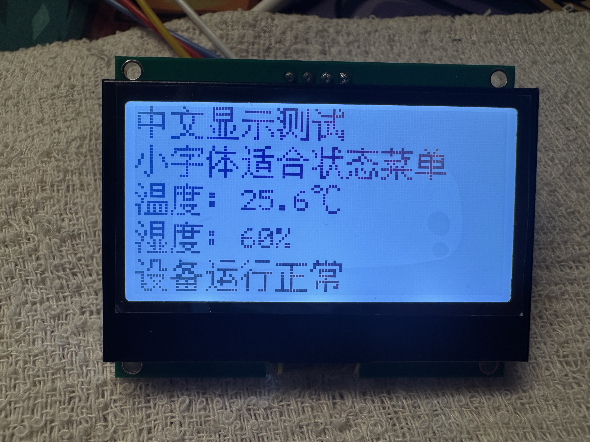
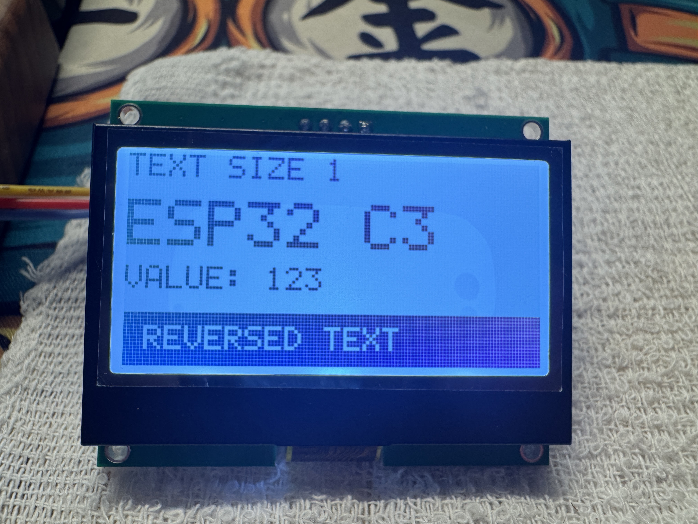

# ST7567S_I2C Arduino 库

用于 ESP32 系列与 ST7567S 128×64 I2C LCD。无第三方依赖，仅使用 Arduino 和 Wire。
从已实物验证的驱动整理：SEG=A0、COM=C8、列偏移=0、默认对比度=38、100kHz。
库封装和示例已在 ESP32-C3 Arduino 框架编译验证，实物显示效果见下方照片。

## 安装及接线

Arduino IDE → 项目/草图 → 导入库 → 添加 .ZIP 库，选择 ST7567S_I2C-1.3.0.zip；升级时替换旧版库，避免重复安装。
随后从 文件 → 示例 → ST7567S_I2C 打开示例。
ESP32-C3 Mini/SuperMini（4MB）选择 ESP32C3 Dev Module；原生 USB 连接时启用 USB CDC On Boot。

| LCD | ESP32-C3 Mini |
| --- | --- |
| VCC | 3.3V（确认模块支持） |
| GND | GND |
| SDA | GPIO4 |
| SCL | GPIO5 |
| RST/RES（可选） | GPIO6 |

四针屏可将 begin 第三个参数设为 -1。如无板载上拉，SDA/SCL 各接 4.7kΩ 到 3.3V。
背光单独按模块规格供电，不能直接由 GPIO 驱动；此库不控制背光。
经典 ESP32 可改用 `lcd.begin(21, 22, 18)`；仅 C3 示例经过本次编译验证。

## 示例

- HelloWorld：初始化、扫描地址、文字和全屏边框。
- GraphicsDemo：每 3 秒切换点线、空心/实心矩形、空心/实心圆、文字缩放、反白文字、位图、柱状图、棋盘格。绘图规则直接注释在示例中。
- ContrastAndSettings：串口 115200，`+/-` 对比度、`o` 列偏移、`i` 反色、`f` 旋转 180 度、`s` 显示开关。设置复位后不保存。
- ChineseFonts：12/16/24 像素中文字库轮播、中英数字混排、居中和反白文字。

## 实物显示效果

以下为 ESP32-C3 Mini 驱动 ST7567S 128×64 LCD 的示例实拍。

### 中文小字体与温湿度显示



### 英文字号缩放与反白文字



### 位图图标与柱状图


### 棋盘格像素测试


## 最小用法

```cpp
#include <ST7567S_I2C.h>
ST7567S_I2C lcd;
void setup() {
  if (!lcd.begin(4, 5, -1)) return;
  lcd.clear();
  lcd.setCursor(0, 0);
  lcd.print("HELLO");
  lcd.drawLine(0, 12, 127, 12);
  lcd.fillRect(10, 20, 40, 20);
  lcd.display();
}
void loop() {}
```

## 绘图规则及接口

坐标原点是左上角 (0,0)，x 向右、y 向下；右下角 (127,63)。越界像素会被裁剪。
`true` 画深色像素，`false` 擦除。显存占 1024 字节。
绘图只修改 RAM，完成一帧后调用 `display()` 才更新屏幕。
`clear()` 仅清空画布，不重置光标、字号或文字颜色。

| 接口 | 规则 |
| --- | --- |
| begin(sda,scl,reset,address,frequency) | 默认 4,5,-1,0,100000；地址 0 自动检测 0x3C～0x3F 第一个应答地址，可指定 7 位地址 0x3F；返回初始化/首次刷新结果 |
| display() | 刷新全部 132 列显存，未使用列清零；返回 I2C 是否全部成功 |
| clear(color=false) | 整屏画布清零或填满 |
| drawPixel(x,y,color=true) | 绘制一个点 |
| getPixel(x,y) | 获取画布像素；越界返回 false |
| drawLine(x0,y0,x1,y1,color=true) | 含两个端点的直线；同 x 为竖线、同 y 为横线 |
| drawRect/fillRect(x,y,w,h,color=true) | 左上角和宽高；宽高非正不画 |
| drawCircle/fillCircle(x,y,r,color=true) | 圆心与半径；负半径不画，空心圆半径上限 1024 |
| drawBitmap(x,y,bits,w,h,color=true) | 逐行位图，每行向上取整 w/8 字节，高位在左；1 画点、0 透明 |
| setCursor(x,y) | 文字左上角，以像素为单位 |
| setTextSize(1..8) | 字符占位 6×8 乘倍率，实际字形 5×7 |
| setTextColor(bool) | 深色字或擦除字；透明背景 |
| setTextWrap(bool) | 默认自动换行；到屏幕底部会裁剪，不自动滚屏 |
| print/println | 继承 Arduino Print，支持整数、HEX、浮点数等输出格式 |
| drawChar(x,y,c,size=1,color=true) | 在指定位置绘制字符 |
| setContrast(0..63) | 对比度，非背光亮度 |
| setColumnOffset(0..4) | 默认 0，下次 display 生效 |
| setFlipped(bool) | 旋转 180 度；不同方向可能需要重新调整列偏移 |
| setInverted(bool) | 屏幕反色 |
| setDisplayEnabled(bool) | 显示开关，非背光开关 |
| address()/contrast()/errors() | 当前地址、对比度、初始化后累计 I2C 写错误数 |

字体包含空格、A～Z、0～9 和标点 `: - . / % ! ? + = _ ( ) > <`。小写转大写；其他字符画方框。
ASCII 接口 print/drawChar 不解析中文；中文请使用下述 drawUTF8。
位图从普通内存读取，在 ESP32 的 const 数组可直接使用。

同一 I2C 总线只需一个调用 begin 的设备负责配置引脚，之后可共享 Wire；该库不提供多任务锁。
错误可通过 begin/display 返回值及 errors() 排查；自动扫描可能选中同地址的其他器件，测试时只接 LCD。

## 中文字体（1.2.0 常用字版）

```cpp
#include <ST7567S_ChineseFonts.h>
// begin 后：
lcd.clear();
lcd.drawUTF8(0, 0, "中文显示测试", ST7567S_CN16);
lcd.drawUTF8(0, 20, "温度: 25.6℃", ST7567S_CN12);
lcd.display();
```

| 字库 | 汉字占位 | 每行最多汉字 | 最多行数（无行距） | 本版点阵+索引 |
| --- | --- | --- | --- | --- |
| ST7567S_CN12 | 12×12 | 10 | 5 | 105364 字节 |
| ST7567S_CN16 | 16×16 | 8 | 4 | 135468 字节 |
| ST7567S_CN24 | 24×24 | 5 | 2 | 285988 字节 |

每套包含 GB2312 一级 3755 个常用汉字，加原有扩展字符，共 3763 个字形；字符清单见 extras/characters.txt。不是全部 Unicode 汉字，生僻字、部分姓名用字和繁体字仍可能缺失。三套点阵与索引共 526820 字节（约 514.5 KiB）。
点阵存储在 Flash，仍共用原有 1024 字节画布。每套在独立编译单元中，标准 ESP32 Arduino 构建可剔除未引用的字体。
12/16px 采用原生文泉驿点阵宋体；24px 是 12px 点阵的 2 倍整数放大，生成时处理，运行时直接绘制。

- `drawUTF8(x,y,text,font,color=true)`：UTF-8 字符串，x/y 为左上角。独立于 setTextSize/setTextColor，颜色由参数控制。默认透明背景；绘图后调用 display。
- `textWidthUTF8(text,font)`：不考虑自动换行的最大一行像素宽度，可计算 `(128-width)/2` 居中；居中场景建议 setTextWrap(false)。
- 中文占完整方形格；ASCII 使用内置 5×7 字形，12/16 字库中占 6×8，24 字库中占 12×16，竖直居中。
- `\n` 换行后回到传入的 x，行高等于中文字库尺寸；自动换行遵循 setTextWrap。超出底部裁剪，不滚屏。
- 缺字或非法 UTF-8 显示方框，drawUTF8 返回 false；边缘裁剪不视为缺字。ASCII 支持范围见前文。
- 中文字符串使用普通 UTF-8 字符串字面量即可；不要传 GBK 编码文件，也不需要加 u8 前缀。

### 补充汉字

1. 编辑 `extras/characters.txt` 添加需要的字符；或将扩展字符添加到 `extras/characters-extra.txt`，再运行 `python tools/generate_common_characters.py` 重建常用字表（重复字符自动合并）。
2. 安装 Python/Pillow：`python -m pip install pillow`。
3. 包中附有所需字符的文泉驿 BDF 源文件；完整字体来源见 `extras/font-source/README.md`。
4. 在库目录执行：`python tools/generate_oled_fonts.py`。如新增的字未收录在 BDF 子集中，可从来源地址下载完整 BDF 替换后再运行。
5. 重新编译 Arduino 项目。生成器同时输出三套字体和 PNG 预览。

当前字体来源为文泉驿点阵宋体（与 U8g2 的 wqy 字体同源），遵循 GPL v2 及字体嵌入例外，版权、完整授权说明和字形源文件随包提供；对子集及放大版本延续该嵌入例外。旧版 Noto 字体生成工具保留作可选方案，其 OFL 授权另附。Python/Pillow 仅用于生成字体，Arduino 编译和运行不依赖 Python。

1.2.0 仍保留原有四个示例和接口，已有示例不需改代码。常用字表由 Python gb2312 编解码器的 B0A1～D7FE 区间生成，并校验恰好 3755 个一级汉字。

1.2.1 字形调整：Noto Sans SC 字重由 500 改为 400，单色转换阈值由 100 改为 128，减少笔画粘连。字数、接口、占用和屏幕参数保持一致。

1.3.0：所有开机默认对比度及示例统一为 38；切换原生点阵中文字库。12/16px 不做阈值减细、不进行非整数缩放；24px 将 12px 像素逐点放大 2 倍。显示方向 A0/C8 和列偏移 0 保持实测参数。
